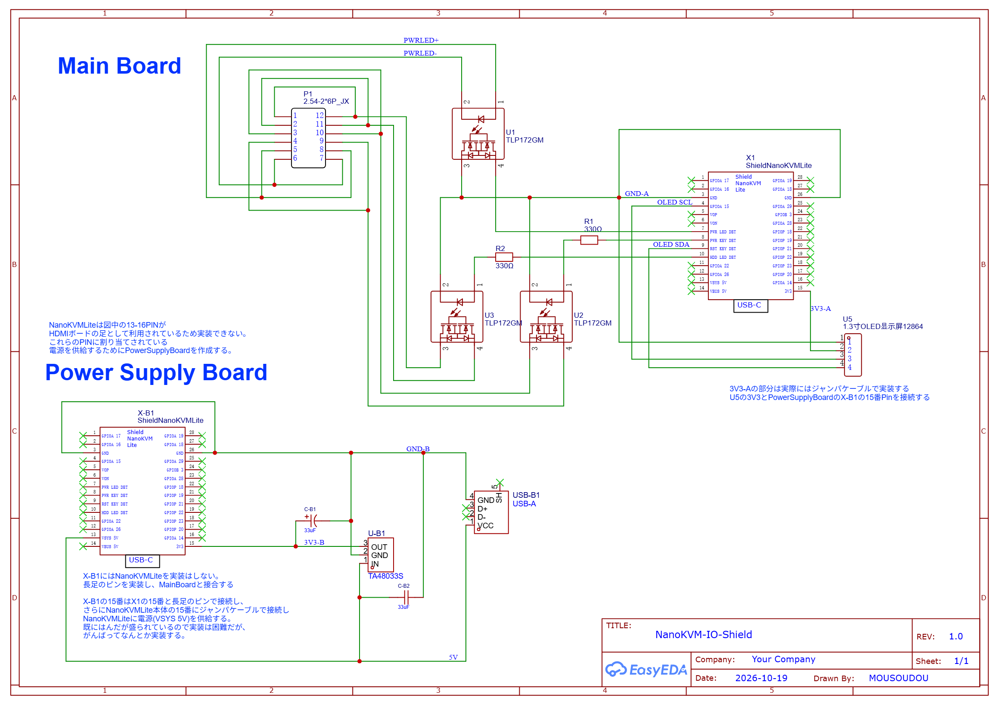
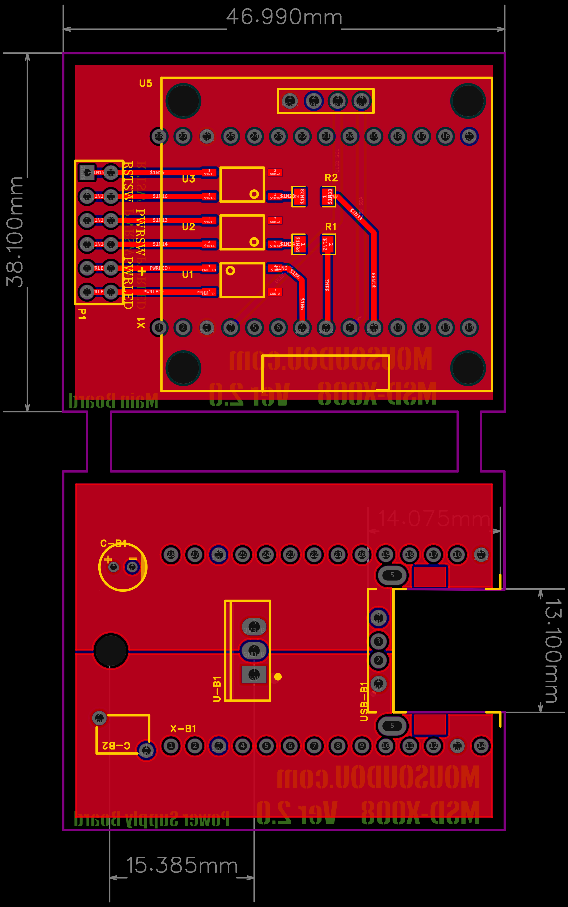
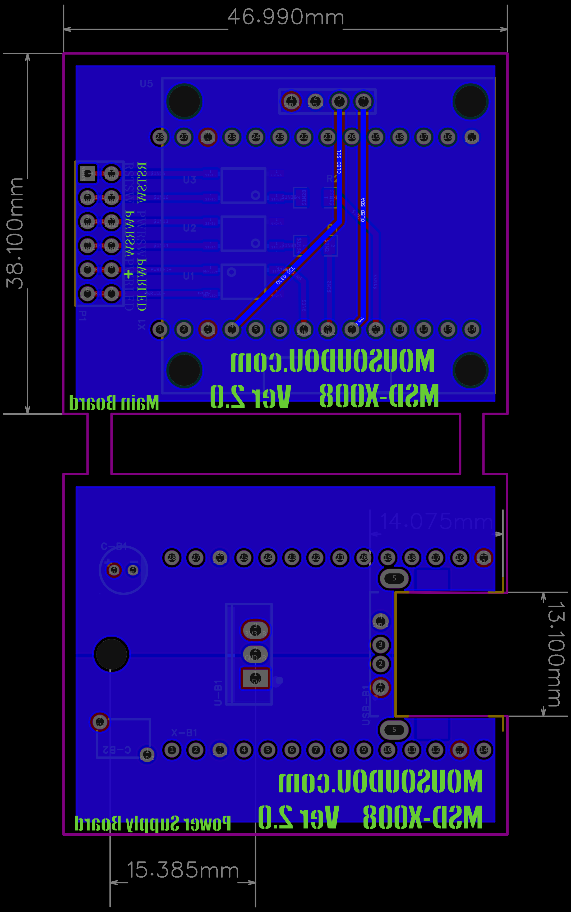
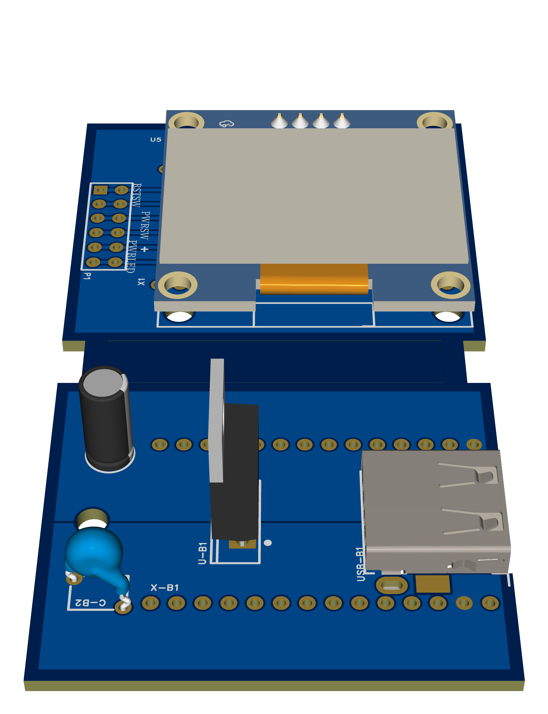
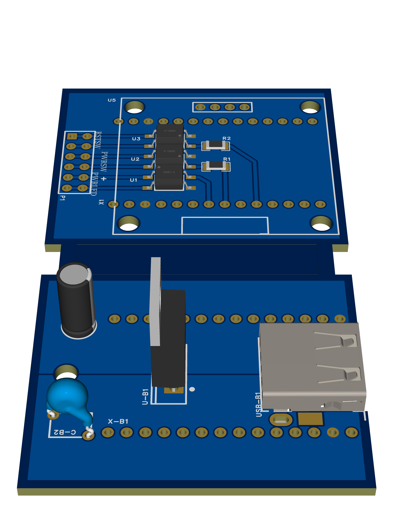
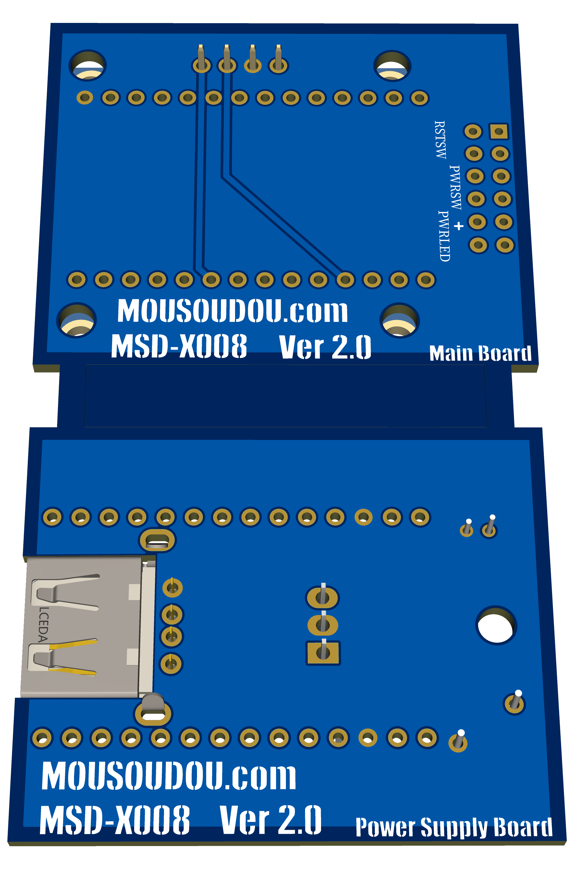

# MSD-X008-NanoKVM_IO_Shield
NanoKVM LiteとATXマザーのPINを接続するためのボード

## 回路図 / Schematic

## 基板 / PCB

| TOP | BOTTOM |
| :---: | :---: |
|  |  |

## 3Dビュー / 3D View

| | | |
| :---: | :---: | :---: |
|  |  |  |

## パーツリスト / Parts List

| No. | Quantity | Comment | Designator |
| --- | --- | --- | --- |
| 1 | 1 | 33uF | C-B1 |
| 2 | 1 | 33uF | C-B2 |
| 3 | 1 | 2.54-2*6P_JX | P1 |
| 4 | 2 | 330Ω | R1,R2 |
| 5 | 3 | TLP172GM | U1,U2,U3 |
| 6 | 1 | 0.96インチ OLEDディスプレイモジュール (128x64 / SSD1306) | U5 |
| 7 | 1 | TA48033S | U-B1 |
| 8 | 1 | USB-A | USB-B1 |
| 9 | 1 | NanoKVM Lite | X1,X-B1 |

## ライセンス / License

**No License**

本リポジトリは公開していますが、ライセンスは付与していません。  
参照・閲覧は自由ですが、利用（複製・改変・再配布等）はご遠慮ください。

## 注意事項

本プロジェクトの回路設計は素人によるものです。  
設計の正確性や安全性は保証できませんので、あらかじめご了承ください。
